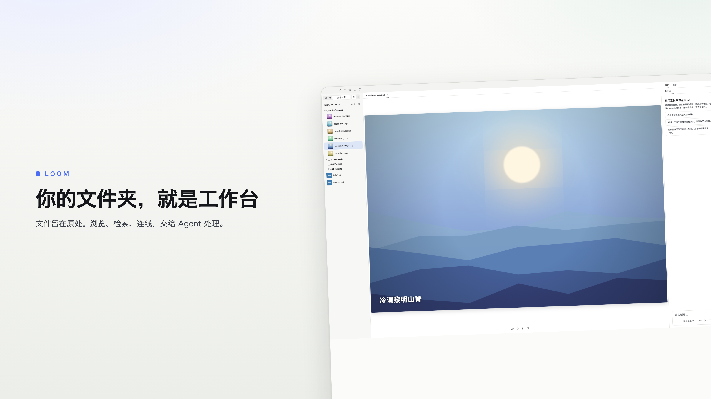

# 你好，我是三藏 / Hi, I’m Sanzang

[个人网站 / Website · sanzang.site](https://sanzang.site)

以前做建筑，后来用 Unreal Engine 做过游戏和地理空间可视化，现在主要在做 **[Loom](https://github.com/Qy-Wen/loom)**。

一路做过的东西有些不同，但设计和开发一直都在其中。最近的精力更多放在 AI 应用上，尤其是 Agent 怎么在具体的软件里把事情做完。

My background is in architecture, with later work in Unreal Engine, games, and geospatial visualization. These days, I’m focused on Loom and building agents that can get things done inside an application.

## 最近在做：Loom
*Currently building: Loom*

做创意项目时，参考图、视频片段、音频和生成结果往往散在不同文件夹里。找素材、预览、处理，再把结果收回来，这些步骤都很琐碎。

Loom 是一个本地优先的 AI 创意素材工作台。打开已有的文件夹，就能浏览和整理素材，也可以让 Agent 帮忙找图、从视频里截帧、裁剪转码，或者调用 ComfyUI 等工具生成新的内容。处理后的结果会回到素材库里，参考素材与产出的关系也可以记录下来。

目前它是我投入最多的项目。从素材浏览、检索到 Agent 实际操作文件，还有很多细节在持续打磨。

Loom is a local-first workspace for creative assets. Open an existing folder to browse and organize your files, then ask an agent to find references, extract video frames, process media, or work with tools like ComfyUI. Results come back into the library, where you can keep track of how source material connects to finished work.

It’s my main project right now, with ongoing work on browsing, search, and how the agent handles real files and tools.

[查看源码 / Source](https://github.com/Qy-Wen/loom) · [下载试用 / Download](https://loom.sanzang.site)

## 以前做过
*Earlier projects*

之前的一些项目留在这里，主要是用 Unreal Engine 做空间展示和交互的尝试。

A few earlier projects exploring spaces and interaction with Unreal Engine.

- **[CesiumHeatExposure](https://github.com/Qy-Wen/CesiumHeatExposure)** — 基于 Unreal Engine 与 Cesium 的热暴露数据交互展示。  
  Interactive heat exposure visualization with Unreal Engine and Cesium.
- **[ShooterGame](https://github.com/Qy-Wen/ShooterGame)** — 用 Unreal Engine 开发的科幻风格第三人称射击游戏。  
  A sci-fi third-person shooter built with Unreal Engine.
